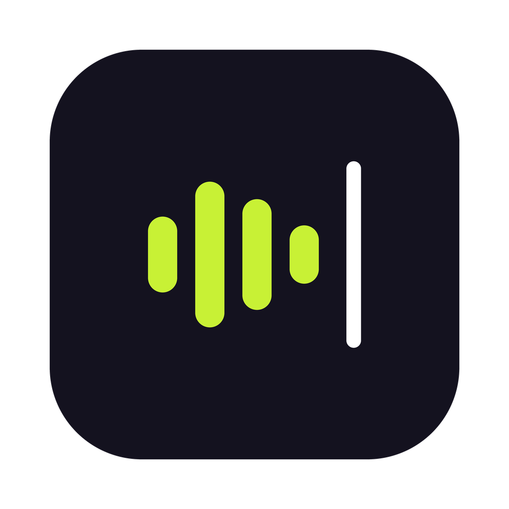

<p align="center">
  
</p>

<h1 align="center">yaptic</h1>

<p align="center">
  Hold a key, talk, let go. Your words appear wherever you're typing.<br>
  Push-to-talk dictation for macOS that runs Whisper on your Mac.
</p>

## Why Yaptic

- Your voice stays on your Mac. Speech recognition is
  [whisper.cpp](https://github.com/ggml-org/whisper.cpp) running locally on
  Apple Silicon with Metal, and audio is never uploaded.
- Cleanup is optional, with the provider of your choice. It removes "um"s,
  fixes punctuation and resolves self-corrections ("jam 3, eh jam 4" becomes
  "jam 4"). Use Anthropic, OpenAI, or any OpenAI-compatible endpoint,
  including Ollama or LM Studio on your own machine. With cleanup off, Yaptic
  works fully offline.
- You can mix Indonesian and English the way you talk. Nothing gets
  translated.
- A custom dictionary keeps names and technical terms such as "Kubernetes"
  and "Tauri" spelled right.
- It works in any app. Text is pasted at the cursor, and your clipboard
  (images and files included) is put back afterwards.

## Requirements

- A Mac with Apple Silicon (M1 or later), macOS 12 or newer.
- About 600 MB of disk space for the speech model.
- For cleanup (optional): an API key from your provider, or a local model
  server such as Ollama or LM Studio, which needs no key.

## Install

### Download

1. Get `Yaptic_<version>_aarch64.dmg` and `SHA256SUMS.txt` from
   [Releases](https://github.com/iniandrew/yaptic/releases). Only download
   Yaptic from this page.
2. Check that the download is the real one. Each release is built by GitHub
   Actions from the tagged source and comes with checksums and a signed
   build-provenance attestation:

   ```bash
   shasum -a 256 -c SHA256SUMS.txt
   gh attestation verify Yaptic_<version>_aarch64.dmg --repo iniandrew/yaptic
   ```

3. Open the `.dmg` and drag Yaptic to Applications.
4. Open Yaptic. Releases aren't signed with an Apple Developer ID yet, so the
   first launch shows *Apple could not verify "Yaptic" is free of malware…*
   Close the message, then allow the app in one of two ways:
   - Open **System Settings → Privacy & Security**, scroll down to
     **Security**, click **Open Anyway** next to the message about Yaptic,
     and confirm with your password or Touch ID.
   - Or remove the download quarantine flag in Terminal:

     ```bash
     xattr -dr com.apple.quarantine /Applications/Yaptic.app
     ```

   You only need to do this once per version. (On macOS 14 and earlier,
   right-clicking the app and choosing **Open** also works; macOS 15 removed
   that shortcut.)

### Build from source

You need Xcode Command Line Tools, Rust, Node.js, and CMake:

```bash
xcode-select --install
brew install rust node cmake
git clone https://github.com/iniandrew/yaptic.git
cd yaptic
npm install
npm run tauri build
```

The app is written to `src-tauri/target/release/bundle/macos/Yaptic.app`, and a
`.dmg` sits next to it in `bundle/dmg/`. See [CONTRIBUTING.md](CONTRIBUTING.md)
for running in development.

## First run

1. Yaptic lives in the menu bar (the bars-and-caret icon). There is no Dock
   icon.
2. The settings window opens and offers to download the speech model
   (Whisper large-v3-turbo, about 550 MB). The download can be paused and
   resumed, and it is checked against a pinned SHA-256 before use.
3. Grant two permissions when macOS asks, or from the Permissions section in
   settings:
   - **Microphone**, to hear you.
   - **Accessibility**, to paste with ⌘V. Without it, Yaptic copies the text
     to your clipboard so you can paste it yourself.

## Using it

Hold **⌥ Space** (Option+Space), speak, and release. A small pill at the
bottom of the screen shows what's happening: lime bars while listening, a
wave while transcribing or cleaning up, then a check once the text is
pasted. Quick taps are ignored, so you won't trigger it by accident.

Open **Settings** from the menu bar icon to change:

- the shortcut (any modifier plus a key, or a function key),
- the language (auto-detect, Indonesian, or English),
- your custom dictionary,
- cleanup (on/off, provider, base URL, model, API key, timeout) with a
  **Test connection** button,
- launch at login and the clipboard restore delay.

### Cleanup providers

| Provider | Base URL | Model | API key |
|---|---|---|---|
| Anthropic | `https://api.anthropic.com` | e.g. `claude-haiku-5-5` | required |
| OpenAI | `https://api.openai.com/v1` | a chat model name | required |
| Ollama | `http://localhost:11434/v1` | e.g. `llama3.2` | none |
| LM Studio | `http://localhost:1234/v1` | the loaded model's name | none |

Groq, OpenRouter, Together and other OpenAI-compatible services work the same
way with their base URL. Settings shows the exact endpoint each request will
go to, and warns you if a remote URL uses plain `http://`. Local models can
be slower than cloud ones, so raise the timeout if cleanup keeps falling
back to the raw text.

## Privacy

- Audio and the speech model never leave your Mac.
- With cleanup off, nothing is sent anywhere.
- With cleanup on, the transcript text goes to the provider and base URL you
  configured, under that provider's own privacy policy. Audio is never sent.
  With a local server such as Ollama, the text stays on your machine too.
- API keys are stored in the macOS Keychain, one per provider. They are never
  written to the settings file or to logs.
- After pasting, your previous clipboard is restored. The dictated text is
  marked as transient so clipboard managers don't keep it.

Settings live in `~/Library/Application Support/io.github.iniandrew.yaptic/`.

## Troubleshooting

**The shortcut or paste does nothing.** macOS ties permissions to a specific
app build. Open System Settings → Privacy & Security → Accessibility (and
Microphone), remove Yaptic, add it again, and relaunch. This is common after
installing a new version. If you run from source with `npm run tauri dev`,
the permissions belong to your terminal app instead.

**The pill says "Speech model not downloaded" or the download stalls.** Open
Settings → Speech model and press **Resume download**. Partial downloads
continue where they stopped.

**macOS says it "could not verify Yaptic is free of malware".** That's
Gatekeeper blocking an app without an Apple Developer ID signature. Go to
System Settings → Privacy & Security and click **Open Anyway**, or run
`xattr -dr com.apple.quarantine /Applications/Yaptic.app`. See step 4 under
[Download](#download).

**Cleanup says it failed.** The raw transcript is still pasted. Press **Test
connection** in settings; it shows the server's real error (wrong key,
unknown model, wrong URL).

**Another app pastes your old clipboard.** Raise the clipboard restore delay
in settings, for example to 600 ms.

## Limitations

- macOS on Apple Silicon only.
- The shortcut must include a key besides modifiers, so Fn alone or Right
  Option alone can't be used yet.
- Auto-detect costs about a second extra per dictation on an M1, because
  whisper detects the language in a separate pass. Picking Indonesian or
  English in settings is faster.
- Cloud cleanup needs internet. Offline, Yaptic pastes the raw transcript,
  or you can turn cleanup off or use a local model.
- Text is pasted into whichever app is in front when transcription finishes,
  so don't switch apps mid-dictation.
- Releases are not signed with an Apple Developer ID yet.

## Contributing and security

See [CONTRIBUTING.md](CONTRIBUTING.md) to build and test.

## License

The code is released under the [MIT License](LICENSE). Third-party components
and their licenses are listed in [THIRD_PARTY_NOTICES.md](THIRD_PARTY_NOTICES.md).

The MIT license covers the code only. The Yaptic name and logo are not
licensed for use as another product's branding. If you ship a fork, please
give it a different name and icon.
